# Monster for Cyberspace

Standalone ESP32 firmware client for [cyberspace.online](https://cyberspace.online),
a retro text-only social network. It runs on the Elecrow ThinkNode M9, with
builds for the Seeed Wio Tracker L2, the LilyGO T-Deck Plus, the Elecrow
CrowPanel Advance 3.5" and 5.0", the LilyGO T-LoRa Pager and the LilyGO T-Deck Pro (not yet tried on hardware), and offers cIRC chat (milestone 1), C-Mail private messages (milestone 2), and a
web config page served by the device. No phone app or companion is needed.

## Screenshots

On the Attaky Mesh Deck, Default theme, from the demo build (made-up users and
messages; docs/BUILD.md).

| | | |
|---|---|---|
| 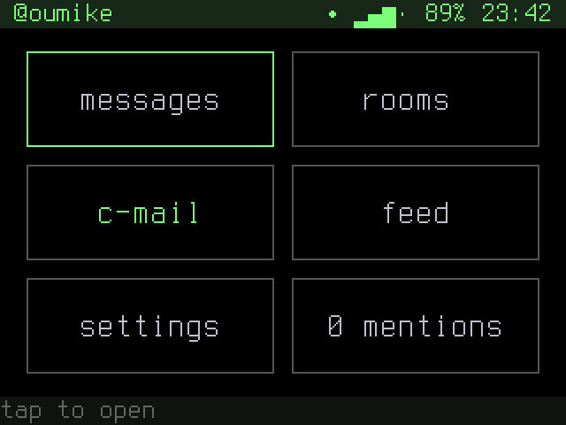 | 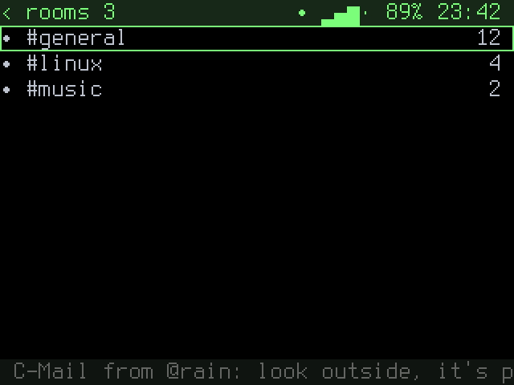 | 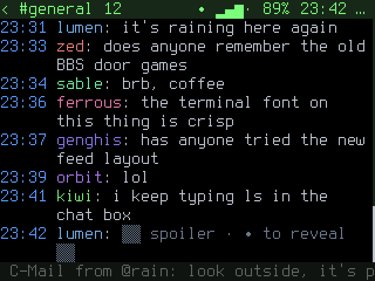 |
| Home | Rooms | A room |
| 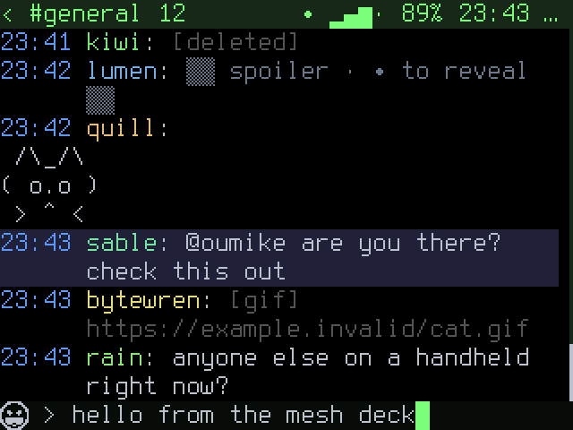 | 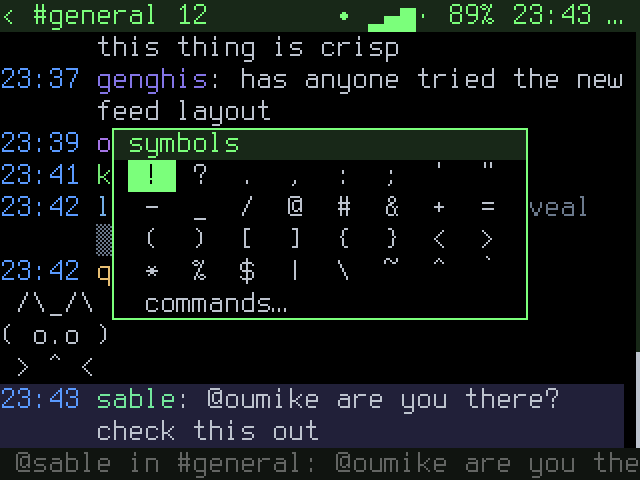 | 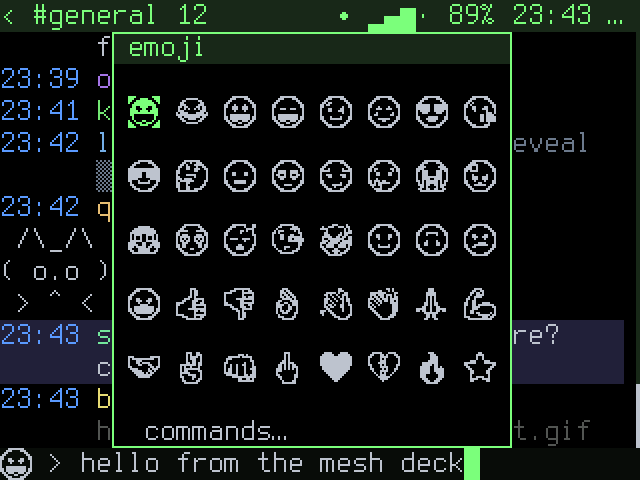 |
| Typing | Symbol table | Emoji tray |
| 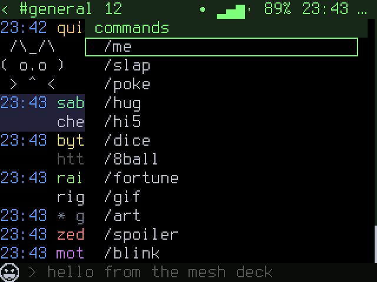 | 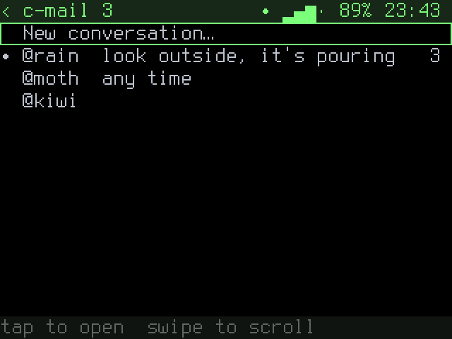 | 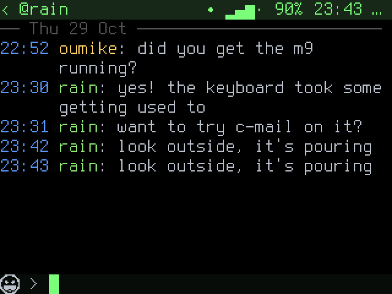 |
| Command palette | C-Mail | A conversation |
| 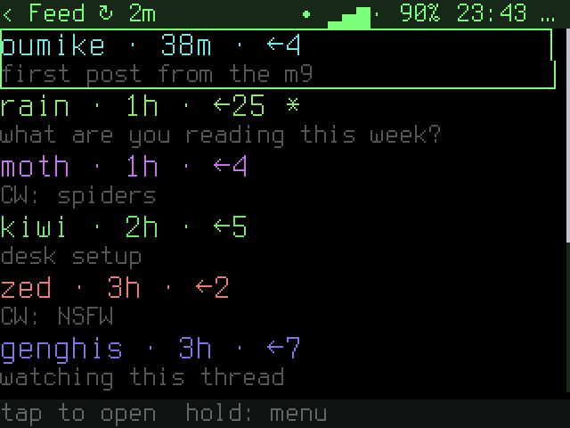 | 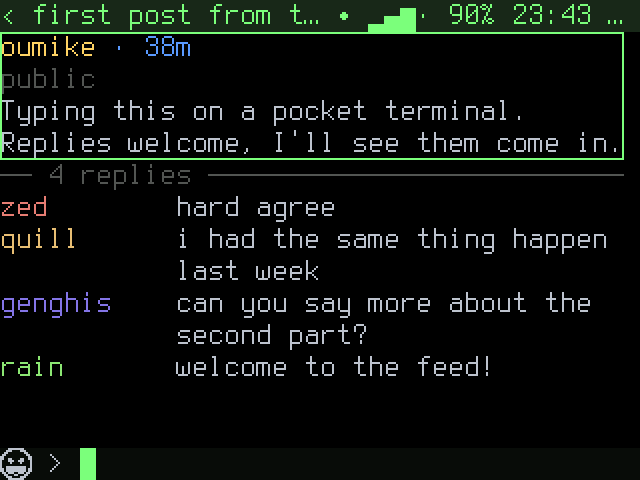 | 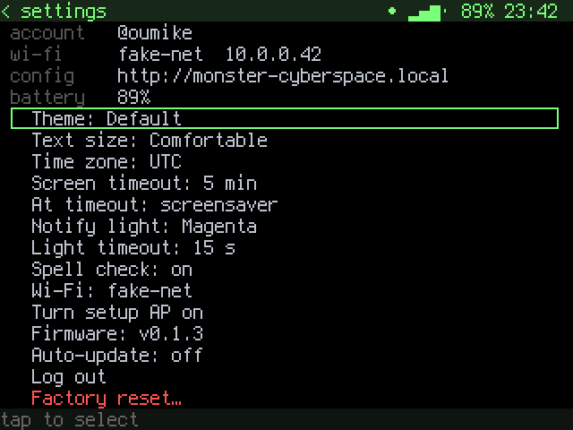 |
| Feed | A post and replies | Settings |
| 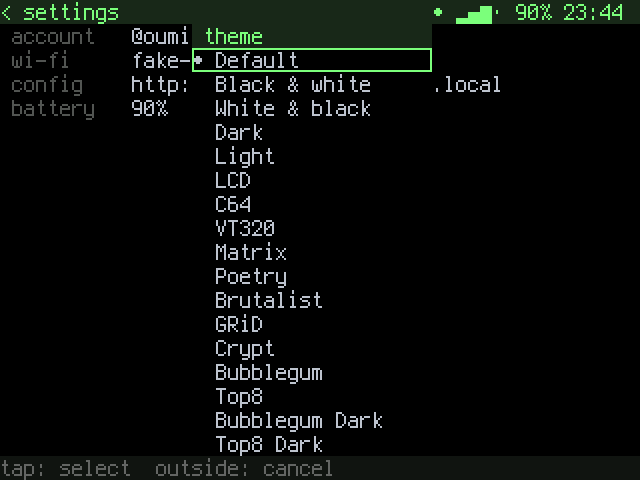 |
| Themes |

## Install

**Browser flasher:** <https://oumike.github.io/monster-cyberspace/>. Plug the
board in over USB and install from Chrome or Edge on a desktop.

Or download `monster-cyberspace-<board>-<version>.bin` for your board from
[Releases](../../releases) and flash it at `0x0` with the `flash.sh` attached to
each release (`./flash.sh monster-cyberspace-<board>-<version>.bin /dev/ttyUSB0`;
on macOS, `/dev/cu.usbmodem*` or `/dev/cu.wchusbserial*`). Installs keep your
Wi-Fi, sign-in and preferences: they live past the end of the image.

After that, updates come over the air (Settings → Firmware, or web config). The
`-ota.bin` files are for that and are not flashed by hand.

## Docs

- [Using it](docs/USE.md): setup, buttons, rooms, C-Mail, web config
- [Building](docs/BUILD.md)
- [Testing](docs/TESTING.md): unit tests, hardware checks and the live checklist
- [Design spec](docs/superpowers/specs/2026-10-25-cyberspace-m9-circ-design.md)
  and [plan](docs/superpowers/plans/2026-10-25-cyberspace-m9-circ.md);
  C-Mail [spec](docs/superpowers/specs/2026-10-25-cyberspace-m9-cmail-design.md)
  and [plan](docs/superpowers/plans/2026-10-25-cyberspace-m9-cmail.md)

Contributors and coding agents: read [AGENTS.md](AGENTS.md) first.

## License

[GPL-3.0](LICENSE). Board code is ported from the GPL-3.0 projects camillia-mt
and platy-aprs. The cell fonts are derived from Terminus Font under the SIL Open
Font License 1.1 ([src/ui/fonts/OFL-Terminus.txt](src/ui/fonts/OFL-Terminus.txt)),
and the emoji are rendered from Noto Emoji under the same licence
([src/ui/fonts/OFL-NotoEmoji.txt](src/ui/fonts/OFL-NotoEmoji.txt)).
The spell-check word list ([dict/en.txt](dict/en.txt)) is from
[hermitdave/FrequencyWords](https://github.com/hermitdave/FrequencyWords)
under CC-BY-SA-4.0.
The cyberspace.online theme colours were taken from the site's palettes as
listed in [z0mbieparade/cyberspace-atmospheric-modulator](https://github.com/z0mbieparade/cyberspace-atmospheric-modulator).
Cyberspace itself is a separate service with its own terms; this project is not
affiliated with it.
